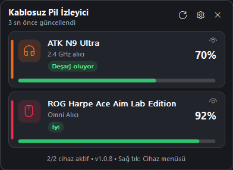
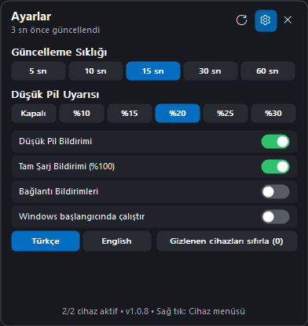

<div align="center">


# Kablosuz Cihaz Pil İzleyici (Wireless Device Battery Monitor)

**Windows 10 & 11 için hafif, üretici yazılımı (bloatware) gerektirmeyen görev çubuğu pil göstergesi ve modern Windows 11 Flyout paneli.**  
*Lightweight, bloatware-free taskbar battery indicator and modern Windows 11 Flyout panel for 70+ wireless mice, keyboards, headsets, earbuds, gamepads, and phones.*

[-0078D4?logo=windows)](https://github.com/emincodesM/Wireless-Device-Battery-Monitor-TURKCE-BYE-EminCodes)
[](https://github.com/emincodesM/Wireless-Device-Battery-Monitor-TURKCE-BYE-EminCodes/releases)
[](https://github.com/emincodesM/Wireless-Device-Battery-Monitor-TURKCE-BYE-EminCodes/actions/workflows/build.yml)
[](LICENSE)

[**İndir / Download (Releases)**](https://github.com/emincodesM/Wireless-Device-Battery-Monitor-TURKCE-BYE-EminCodes/releases) • [**Desteklenen Cihazlar**](#-desteklenen-cihazlar-ve-sürücüler-supported-devices--v108) • [**Kurulum**](#-kurulum-ve-kullanım-installation--usage) • [**Yeni Cihaz Talebi**](https://github.com/emincodesM/Wireless-Device-Battery-Monitor-TURKCE-BYE-EminCodes/issues/new?template=device_request.md)

<br>

<p align="center">
  
  &nbsp;&nbsp;
  
</p>

</div>

---

## 🌟 Öne Çıkan Özellikler (Key Features)

- **Görev Çubuğu Widget'ı (Native Taskbar Widget):** Saatin ve sistem tepsisinin hemen soluna yerleşir; bağlı her kablosuz cihaz için cihaz türü simgesini ve pil yüzdesini (veya pil çubuğunu) canlı olarak gösterir. Çoklu monitör (ikincil görev çubuğu) ve dikey görev çubuklarıyla tam uyumludur.
- **Modern Windows 11 Flyout Paneli:** Tepsi ikonuna veya görev çubuğu widget'ına **sol tıkladığınızda** açılan yuvarlatılmış köşeli, koyu/açık tema duyarlı kontrol paneli:
  - Her cihaz için büyük pil yüzdesi, renkli ilerleme çubuğu, bağlantı türü (`2.4 GHz alıcı`, `Bluetooth`, `USB kablo`, `Omni Alıcı`), voltaj (`mV`) ve AirPods / Galaxy Buds için `Sol / Sağ / Kutu` pil dağılımı.
  - **Deşarj Hızı ve Kalan Süre Tahmini (ETA):** `~14 sa 20 dk kaldı (-3.2%/sa)` veya `~40 dk sonra tam dolu` hesaplaması ve **mini pil geçmişi grafiği (sparkline)**.
  - **Uygulama İçi Ayarlar Paneli (`⚙`):** Güncelleme sıklığı (`5–60 sn`), düşük pil uyarı eşiği (`%10–%30`), bildirim tercihleri, Windows başlangıcında çalıştırma ve dil seçimi (`Türkçe` / `English` + 12 dil).
  - **Hızlı Görev Çubuğu Gizleme (`👁`):** Kart üzerindeki göz simgesiyle cihazı görev çubuğunda tek tıkla gizleyip gösterme.
- **Sıfır Arka Plan Bloatware:** Razer Synapse, Logitech G HUB, Armoury Crate, iCUE, NGENUITY veya ATK HUB kurmanıza gerek kalmadan **70+ üretici protokolünü** doğrudan saf C++17 ve Win32 HID / BLE / RFCOMM / Serial üzerinden okur.
- **%100 Çevrimdışı ve Gizlilik Odaklı:** Hiçbir ağ bağlantısı, telemetri veya arka plan servisi içermez; cihazlara yalnızca salt-okunur pil sorguları gönderir.

---

## 🎮 Desteklenen Cihazlar ve Sürücüler (Supported Devices — v1.0.8)

| Kategori | Marka / Sürücü Modülü | Desteklenen Modeller ve Bağlantı Türleri |
|---|---|---|
| **Fareler (Mice)** | **Razer** (`razer.cpp`) | Viper Ultimate / V2 Pro / V3 Pro / V3 HyperSpeed, DeathAdder V2 Pro / V3 Pro / V3 HyperSpeed, Basilisk Ultimate / V3 Pro, Naga Pro / V2 Pro, Cobra Pro, Orochi V2 |
| | **Logitech** (`logitech.cpp`) | G PRO X Superlight 1 & 2 / DEX, G502 X Lightspeed / Plus, G502 / G703 / G903 / G305 / G303 Shroud, MX Master / MX Anywhere / Lift / Pebble (Lightspeed, Bolt, Unifying, Bluetooth) |
| | **ASUS ROG** (`rog.cpp`) | Harpe Ace Aim Lab / Extreme / Mini / II Ace, Keris Wireless / AimPoint / II Ace / II Origin, Gladius II / III Wireless / AimPoint, Chakram / Chakram X, Spatha X, Strix Impact II / III Wireless, Omni Receiver |
| | **SteelSeries** (`steelseries.cpp`) | Aerox 3 / 5 / 9 Wireless, Rival 3 / 650 Wireless, Prime / Prime Mini Wireless |
| | **Corsair** (`corsair.cpp`) | Dark Core RGB Pro, Ironclaw RGB Wireless, Harpoon RGB Wireless, Katar Pro Wireless, M75 Air / Wireless, Sabre RGB Pro Wireless |
| | **HyperX** (`hyperx.cpp`) | Pulsefire Haste Wireless, Pulsefire Haste 2 Wireless, Pulsefire Haste 2 Core Wireless, Pulsefire Dart |
| | **Pulsar** (`pulsar.cpp`) | X2 / X2V2 / X2V3 / X2H / X2A, Xlite V2 / V3 / V4, Feinmann F01 (`1K/4K/8K` dongle + kablo) |
| | **Lamzu** (`lamzu.cpp`) | Atlantis OG / Mini / 4K, Maya / Maya X, Thorn, Paro |
| | **ATK / VXE / VGN** (`kysona.cpp`, `atk_bitmouse.cpp`, `atk_nordic54.cpp`) | VXE Dragonfly R1 / Mad R, VGN Dragonfly F1, ATK Blazing Sky F1 / X1 / Z1 (V1 & V2 Nordic 54L15 64-bayt HID), ATK Zero, ATK A9 / U2 |
| | **MCHOSE** (`mchose.cpp`, `mchose_modern.cpp`, `mchose_g3.cpp`) | A5 / A7 / L7 / M7 / K7 V2 Ultra+ / AX5, G3 / G3 V2 / G3 Ultra |
| | **Kysona / Attack Shark / Ajazz** (`kysona.cpp`, `misc_mice.cpp`) | Kysona M600 / Aztec / Uranus, Attack Shark X3 / X6 / R1, Ajazz AJ139 / AJ159 / AJ179 / AJ199, Delux M800 / M900 Pro, Zaopin Z1 / Z2, Incott, RAWM |
| | **WLmouse & Finalmouse** (`wlmouse.cpp`, `finalmouse.cpp`) | Beast X / Beast X Mini / Beast X Max / Sword X, UltralightX (ULX) / Starlight X |
| | **ZOWIE & VAXEE** (`zowie.cpp`, `vaxee.cpp`) | ZOWIE EC1/EC2/EC3-CW, U2, U2-DW / FK2-DW / ZA13-DW / S2-DW; VAXEE XE / NP-01S V2 / Outset AX / E1 Wireless |
| | **Endgame Gear, Ninjutso, Sprime, Darmoshark, Fantech, Dareu, Rapoo** | XM2we / OP1we / XM2w 4k / OP1w 4k (`endgame*.cpp`), Sora V2 / Ten / Ten Air (`ninjutso.cpp`), PM1 (`sprime.cpp`), M3 / N3 (`darmoshark.cpp`), Helios Go XD5 / II Pro (`fantech.cpp`), EM901X / A950 Pro (`dareu.cpp`), VT0 / VT1 / VT2 / VT3 / VT7 / VT9 (`rapoo.cpp`) |
| | **Diğer Fareler** | Glorious Model O / D / I (1 & 2) & Hitscan (`glorious.cpp`), Cooler Master MM712 (`coolermaster.cpp`), Arbiter Studio Akitsu (`arbiter.cpp`), CHERRY (`cherry.cpp`), MSI VERSA 300 / CLUTCH (`msi.cpp`), NZXT Lift Elite (`nzxt.cpp`), Machenike L7 (`machenike.cpp`), Niceboy MW400 (`niceboy.cpp`), Redragon (`areson.cpp`), Royal Kludge MG6 Pro (`royal_kludge.cpp`), ARDOR Fury V2 |
| **Klavyeler (Keyboards)** | **AULA & Epomaker** (`aula.cpp`, `rongyuan.cpp`, `sonix.cpp`) | AULA F75, F87 / F87 Pro, F99, F108 Pro, HERO 68 Air, S99, F65 (2.4 GHz & Bluetooth) |
| | **Keychron & Lemokey** (`keychron.cpp`) | K Pro / K Max, Q Pro / Q Max, V Max, B1/B6 Pro, Lemokey P1 / L1, Nape Pro (2.4 GHz Link & Bluetooth) |
| | **ATK, ASUS ROG, AJAZZ, CHERRY** (`atk_keyboard.cpp`, `rog.cpp`, `sonix.cpp`, `semico.cpp`, `cherry.cpp`) | ATK V75X / RS7 / Z65, ASUS ROG Azoth / Azoth Extreme / Falchion RX / Strix Scope II 96, AJAZZ AK820 MAX / AK980 V2, Attack Shark X98 / K86, CHERRY MX 3.0S Wireless |
| **Kulaklıklar & TWS (Headsets & Earbuds)** | **Apple AirPods & Beats** (`airpods.cpp`) | AirPods 1–4, AirPods Pro 1–3, AirPods Max (Lightning & USB-C), Beats Solo / Studio / Powerbeats / Fit Pro (`Sol / Sağ / Kutu` pil yüzdeleriyle) |
| | **Samsung Galaxy Buds** (`galaxy_buds.cpp`) | Galaxy Buds, Buds+, Buds Live, Buds Pro, Buds2, Buds2 Pro, Buds FE, Buds3, Buds3 Pro (`Sol / Sağ / Kutu` pil yüzdeleriyle) |
| | **HyperX** (`hyperx.cpp`) | Cloud III Wireless, **Cloud III S Wireless (`03F0:06BE`, `03F0:02CC`)**, Cloud Alpha / Alpha 2 Wireless, Cloud II / II Core Wireless, Cloud Flight, Cloud Stinger Core Wireless, Cloud Core Wireless (DTS) |
| | **ATK Neptune** (`atk_serial.cpp`) | ATK Neptune N9 Ultra, ATK Neptune N9 Pro (2.4 GHz Dongle & USB Kablo, akıllı COM port önbellekleme ile) |
| | **Razer** (`razer_headset.cpp`, `barracuda_pro.cpp`) | BlackShark V2 Pro (2020 & 2023) / V2 HyperSpeed / V3 Pro, Kraken V3 Pro / HyperSense / V4 / V4 Pro, Barracuda / Barracuda X / Barracuda Pro |
| | **Logitech & ASTRO** (`logitech.cpp`, `logitech_g435_0adf.cpp`, `astro.cpp`) | G PRO X / X 2 Lightspeed, G733, G535, **G435 (`046D:0ADF`)**, Zone Vibe / Wireless, ASTRO A30 / A50 Gen 4 / A50 X / Gen 5 |
| | **SteelSeries** (`steelseries.cpp`, `steelseries_elite.cpp`) | Arctis 1 / 7 / 7+ / 7P / 7X / 9 / Pro Wireless, Arctis Nova 4 / 5 / 7 / Pro Wireless / **Nova Elite** |
| | **ASUS ROG, Sony, Audeze, Corsair, JBL, Jabra, Poly** | ROG Pelta & ROG Delta II (`rog.cpp`), Sony INZONE H5 / H7 / H9 / H9 II / Buds (`sony_inzone.cpp`), Audeze Maxwell (`audeze.cpp`), Corsair Virtuoso / Void / HS80 (`corsair.cpp`), JBL Quantum (`jbl.cpp`), Jabra Evolve / Engage (`jabra.cpp`), Plantronics / Poly BT600 (`plantronics.cpp`), Fractal Scape (`fractal.cpp`), Alienware AW920H (`alienware.cpp`), MCHOSE V9 Pro 2 (`mchose_headset.cpp`), Maono PD200W (`maono.cpp`), Moondrop GM01 Pro (`moondrop.cpp`) |
| **Oyun Kolları & Telefon (Gamepads & Phone)** | **Xbox, PlayStation, Switch, Steam, 8BitDo, Flydigi, GameSir** | Xbox One / Series / Elite (`xinput.cpp` WinRT mWh + XInput), DualSense / DualSense Edge / DualShock 4 (`playstation.cpp`), Switch Pro / Joy-Con (`switch_pro.cpp`), Steam Controller (`steam_controller.cpp`), 8BitDo Ultimate 2 / 3-mode / 2C / Pro 2 / Pro 3 (`eightbitdo.cpp`), Flydigi Vader 5 Pro (`flydigi.cpp`), GameSir Nova / Cyclone 2 (`gamesir.cpp`), Beitong KP20 (`beitong.cpp`) |
| | **Microsoft Phone Link** (`phonelink.cpp`) | Windows 11 Telefon Bağlantısı (Phone Link) ile eşleştirilmiş Android / iPhone telefonlar |

---

## 🚀 Kurulum ve Kullanım (Installation & Usage)

### 1. Hazır Kurulum Sihirbazı veya Taşınabilir (Portable) Sürüm
1. [**Releases**](https://github.com/emincodesM/Wireless-Device-Battery-Monitor-TURKCE-BYE-EminCodes/releases) sayfasından `WirelessBattery-Setup-1.0.8.exe` (Türkçe Kurulum Sihirbazı) veya `WirelessBattery-1.0.8-portable.zip` dosyasını indirin.
2. Uygulama çalıştığında görev çubuğunun sağ alt köşesinde bağlı cihazlarınızın pil yüzdeleri belirecektir.
3. **Sol Tık:** Modern Windows 11 Flyout pil panelini ve etkileşimli ayarlar görünümünü (`⚙`) açar.
4. **Sağ Tık:** Hızlı bağlam menüsünü açar.

### 2. Komut Satırı Seçenekleri (CLI Flags)
```powershell
.\WirelessBattery.exe --list      # Algılanan cihazları ve pil yüzdelerini listeler
.\WirelessBattery.exe --dump      # Tüm HID/COM/Bluetooth tanılama raporunu oluşturur
.\WirelessBattery.exe --debug     # %LOCALAPPDATA%\WirelessBattery\debug.log dosyasına tanı kaydı yazar
.\WirelessBattery.exe --version   # Sürüm bilgisini yazdırır
.\WirelessBattery.exe --help      # Yardım metnini gösterir
```

---

## 🛠️ Kaynak Koddan Derleme (Building from Source)

Proje **MinGW-w64 (`g++` ve `windres`)** ile hiçbir harici kütüphane indirmeye gerek kalmadan derlenir:

```powershell
# MSYS2 MINGW64 / UCRT64 veya WinLibs ile:
make

# Veya doğrudan Windows Komut İstemi / PowerShell üzerinden:
.\build.bat

# Birim testlerini çalıştırmak için:
make test

# Yerli Türkçe Kurulum Sihirbazını (Setup.exe) ve Portable ZIP paketini oluşturmak için:
powershell -ExecutionPolicy Bypass -File .\installer\build-installer.ps1
```

Daha fazla teknik bilgi için:
- [Mimari Genel Bakış (`docs/ARCHITECTURE.md`)](docs/ARCHITECTURE.md)
- [Yeni Sürücü Ekleme Rehberi (`docs/ADDING_A_DRIVER.md`)](docs/ADDING_A_DRIVER.md)
- [Katkıda Bulunma Rehberi (`CONTRIBUTING.md`)](CONTRIBUTING.md)
- [Değişiklik Günlüğü (`CHANGELOG.md`)](CHANGELOG.md)

---

## 📄 Lisans ve Teşekkür (License & Acknowledgements)

Bu proje [GNU General Public License v3.0 (GPL-3.0)](LICENSE) kapsamında lisanslanmıştır.  
Orijinal çekirdek sürücü mimarisi [krisgfx9/Wireless-Device-Battery-Monitor](https://github.com/krisgfx9/Wireless-Device-Battery-Monitor) projesine dayanmakta olup, bu sürümde Modern Windows 11 Flyout arayüzü, Türkçe yerelleştirme, deşarj hızı/süre tahmini (ETA), uygulama içi ayarlar paneli ve genişletilmiş donanım yamaları ile geliştirilmiştir.
