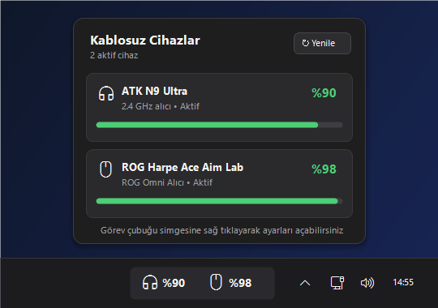

# Wireless Battery (Enhanced Edition / Gelişmiş Sürüm)

Battery levels of your wireless mouse, headset, keyboard and controller, right on the Windows taskbar.  
*Kablosuz fare, kulaklık, klavye ve oyun kollarınızın pil seviyeleri doğrudan Windows görev çubuğunda.*



[](https://github.com/emincodesM/Wireless-Device-Battery-Monitor-TURKCE-BYE-EminCodes/releases/latest)
[](https://github.com/emincodesM/Wireless-Device-Battery-Monitor-TURKCE-BYE-EminCodes/actions)

> **Hemen Kurmak İster misiniz?**  
> Sağ taraftaki **Releases** bölümünden veya **[buraya tıklayarak son sürümden](https://github.com/emincodesM/Wireless-Device-Battery-Monitor-TURKCE-BYE-EminCodes/releases/latest)** **`WirelessBattery-Setup-1.0.0.exe`** dosyasını indirip tek tıkla kurabilirsiniz.

---

### 🌟 Enhanced Edition Highlights (Özel Sürüm Yenilikleri)

- 🎧 **ATK N9 Ultra Kablosuz Kulaklık Desteği:** ATK N9 Ultra (`VID 373B`, `PID 1204` 2.4 GHz alıcı & `PID 1203` USB kablolu) için USB sanal COM portu üzerinden tam pil ve şarj takibi eklendi.
- 🖱️ **ASUS ROG Harpe Ace Çift Bağlantı / Akıllı Öncelik Düzeltmesi:** Hem USB kablosu hem 2.4 GHz dongle takılıyken (şarj esnasında) kablodan gelen canlı pil verisine öncelik verilir, fare uyku modunda veya %0 kalmaz.
- 🪟 **Modern Windows 11 Açılır Panel (Flyout UI):** Görev çubuğundaki pil widget'ına sol tıklandığında açılan modern, şık flyout penceresi (cihaz listesi, renkli pil çubukları, bağlantı türü, şarj durumu ve anında yenileme).
- 🇹🇷 **Tam Türkçe Arayüz & Bildirimler:** Görev çubuğu widget'ında `%XX` formatı, Türkçe menüler, ipuçları ve düşük pil Windows bildirimleri.
- 📦 **Dahili Hafif Kurulum Sihirbazı (Native Win32 Setup):** Ek yazılıma gerek kalmadan doğrudan MinGW ile derlenebilen, AppData'ya kuran ve Windows başlangıcına otomatik ekleyen installer (`installer/build-installer.ps1`).

---

## Özellikler / Features

- **Hafif ve Hızlı (Tiny):** ~450 KB boyutunda, ~2-3 MB RAM tüketen saf C++/Win32 uygulaması. Arka plan servisi veya runtime gerektirmez.
- **Üretici Yazılımlarına İhtiyaç Duymaz:** Cihazlarla doğrudan standart Windows sürücüleri üzerinden haberleşir. Armoury Crate, ATK HUB, G HUB, Synapse, iCUE kapalı olsa dahi çalışır (açık olmaları durumunda da çakışmaz).
- **Geniş Marka Desteği:** ATK, ASUS ROG, Logitech, Razer, SteelSeries, Corsair, HyperX, Glorious, PlayStation ve Xbox kolları, Bluetooth cihazları ve HeadsetControl uyumlu tüm kulaklıklar.

## Arayüz / Display

**Görev Çubuğunda (Varsayılan):** Bildirim alanının yanında `🎧 %90  🖱 %98` şeklinde gösterilir.
- **Sol Tıklama:** Modern Windows 11 Flyout panelini açar / kapatır.
- **Sağ Tıklama:** Cihaz seçimi, yenileme, başlangıçta çalışma ve çıkış menüsünü açar.
- **Düşük Pil:** %15 veya daha az olduğunda sayı kırmızı renge döner ve masaüstü bildirimi gönderilir.
- **Şarj Durumu:** Şarj olurken sayının yanında mavi ⚡ simgesi belirir.
- **Uyku Modu:** Cihaz uykuya geçtiğinde son bilinen değer soluk renkte tutulur.

---

## Desteklenen Cihazlar / Supported Devices

| Üretici / Marka | Desteklenen Cihazlar | İletişim Yöntemi |
|---|---|---|
| **ATK Kulaklıklar** | **ATK N9 Ultra** *(Yeni)*, ATK N9 Pro | USB CDC Sanal Seri Port protokolü (2.4 GHz alıcı & USB kablo) |
| **ASUS ROG** | **ROG Harpe Ace Aim Lab Edition** *(Akıllı öncelik düzeltmeli)*, Harpe Ace Extreme/Mini, Azoth, Falchion, Keris, Gladius, Chakram, Spatha, Pugio, Strix Impact, ROG Omni Alıcı | ROG HID doğrudan pil sorgusu ve çoklu bağlantı birleştirme |
| **Logitech** | Lightspeed, Unifying, Bolt ve Nano alıcılı fare ve klavyeler; G serisi kulaklıklar (G533, G535, G733, G PRO/PRO X vb.) | HID++ 1.0 / 2.0 protokolü |
| **Razer** | Kablosuz fareler, klavyeler ve dongle'lar; BlackShark V3 / V3 Pro kulaklıklar | Razer feature-report & headset envelope protokolü |
| **SteelSeries** | Arctis 1/7/9/Pro/Nova serisi; Aerox 3/5/9, Prime, Rival serisi | Vendor HID raporları |
| **Corsair** | Void / HS70 / HS80 serisi; Virtuoso, Slipstream fare ve klavyeler | Vendor HID ve Bragi GET protokolü |
| **Cooler Master** | MM712, MM731 (2.4 GHz alıcı veya USB kablo) | Vendor HID durum raporu |
| **HyperX** | Cloud III Wireless, Cloud II Wireless, Cloud Alpha Wireless, Flight serisi | Vendor HID raporları |
| **Glorious & Hitscan** | Model O / D / O 2 / D 2 PRO; Hitscan Hyperlight | Vendor feature report |
| **Kysona / Pulsar / VXE** | Kysona M600, Pulsar fareler, ATK/VXE fareler (F1 serisi vb.) | Ortak vendor protokolü |
| **Keychron** | M4 ve 2.4 GHz Keychron fareler, 8K TurboLink alıcılar | Keychron Launcher rapor formatı |
| **LAMZU** | Maya X, Maya, Atlantis Mini, Thorn, Paro vb. | LAMZU Aurora protokolü |
| **Rapoo VT** | VT3 Max Gen 2, Nordic 54L VT fareler | Pasif HID durum raporları |
| **Rongyuan / Attack Shark** | Attack Shark R3, X6, X11, Ajazz klavyeler vb. | Rongyuan alıcı durum raporları |
| **Sony** | DualShock 4, DualSense, DualSense Edge; INZONE H9 II ve H5 | Direct Input & INZONE vendor protokolü |
| **GameSir & Xbox** | GameSir Nova Lite / Nova 2; Xbox One / Series kolları | Windows.Gaming.Input & XInput |
| **Bluetooth & Standart HID** | Windows Bluetooth ayarlarında pil gösteren tüm cihazlar; Standart HID batarya raporu sunan cihazlar | Windows Device API & HID Battery Usage |
| **HeadsetControl** | HeadsetControl tarafından desteklenen tüm kulaklıklar | Harici `headsetcontrol.exe` desteği |

---

## Kurulum / Installation

### Yöntem 1: Hazır Kurulum Dosyası (Setup)
1. `installer\build-installer.ps1` ile oluşturulan `WirelessBattery-Setup-1.0.0.exe` dosyasını çalıştırın.
2. Kurulum otomatik olarak uygulamayı `%LOCALAPPDATA%\Programs\Wireless Battery` dizinine yerleştirir, Başlat Menüsü kısayolunu oluşturur ve Windows başlangıcına ekler.

### Yöntem 2: Taşınabilir (Portable) Sürüm
`WirelessBattery.exe` dosyasını dilediğiniz bir klasöre kopyalayıp doğrudan çalıştırabilirsiniz.

---

## Derleme / Building from Source

Projeyi derlemek için **MinGW-w64** (g++ ve windres) gereklidir.

```cmd
# Windows CMD ile doğrudan derleme:
build.bat

# Veya MSYS2 / Make kullanarak:
make
```

### Kurulum Paketini Derleme (Installer):
```powershell
powershell -ExecutionPolicy Bypass -File installer\build-installer.ps1
```
Bu komut `dist\WirelessBattery-Setup-1.0.0.exe` ve `dist\WirelessBattery-1.0.0-portable.zip` paketlerini üretir.

---

## Komut Satırı Seçenekleri / Command Line

```cmd
WirelessBattery.exe --list   # Algılanan cihazları ve pil yüzdelerini konsola yazdırır ve çıkar
WirelessBattery.exe --dump   # Sistemdeki tüm HID koleksiyonlarını listeler
WirelessBattery.exe --quit   # Arka planda çalışan uygulamayı kapatır
```

---

## Katkıda Bulunanlar & Krediler / Credits

Bu proje [krisgfx9/Wireless-Device-Battery-Monitor](https://github.com/krisgfx9/Wireless-Device-Battery-Monitor) projesinin geliştirilmiş ve zenginleştirilmiş özel sürümüdür.

Cihaz protokolleri ve araştırmalar:
- [HeadsetControl](https://github.com/Sapd/HeadsetControl)
- [OpenRazer](https://github.com/openrazer/openrazer)
- [Solaar](https://github.com/pwr-Solaar/Solaar)
- [G-Helper](https://github.com/seerge/g-helper) & [peripheral-battery-tray](https://github.com/SteveWang92/peripheral-battery-tray)
- [hid-kysona](https://github.com/lodewillems)
- ATK HUB & Beibinghe Technology protokol analizleri

## Lisans / License

[GNU General Public License v3.0 or later](LICENSE).
