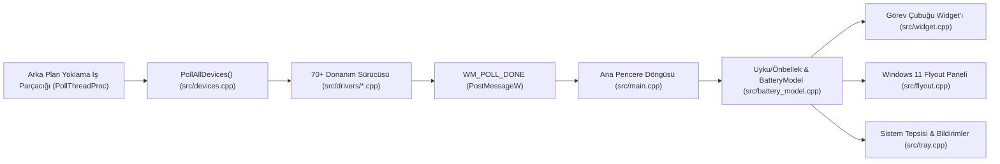

# Mimari Genel Bakış (Architecture Overview)

**Wireless Device Battery Monitor**, Windows 10 ve Windows 11 üzerinde harici çalışma zamanı (runtime) bağımlılığı olmadan çalışan, saf C++17 ve Win32 API ile geliştirilmiş bir sistem aracıdır.

## Veri Akışı (Data Flow)

## Temel Bileşenler

| Modül | Sorumluluk |
|---|---|
| `src/main.cpp` | Uygulama girişi (`wWinMain`), CLI argümanları (`--list`, `--dump`, `--debug`, `--version`, `--help`), tek örnek (single-instance) kontrolü, arka plan yoklama iş parçacığı ve önbellek (`graceSec`) yönetimi. |
| `src/devices.h` / `src/devices.cpp` | `DeviceStatus` veri modeli, `PollAllDevices()` orkestrasyonu, üretici ön eki (`BrandPrefix`), `GuessKind()` cihaz türü sınıflandırması ve `--dump` tanılama çıktısı. |
| `src/hid.h` / `src/hid.cpp` | `SetupAPI` ve `hid.dll` üzerinden çakışmasız (overlapped I/O) HID koleksiyon taraması ve okuma/yazma işlemleri. |
| `src/drivers/drivers.h` | `PollContext`, `(vid, pid)` sahiplik (`Claim`) mekanizması, `MergeByKey` birleştiricisi ve tüm sürücü bildirimleri. |
| `src/widget.h` / `src/widget.cpp` | Birincil (`Shell_TrayWnd`) ve ikincil (`Shell_SecondaryTrayWnd`) görev çubuklarına yerleşen GDI+/UIAutomation pil göstergesi. |
| `src/flyout.h` / `src/flyout.cpp` | Modern Windows 11 Flyout penceresi, cihaz kartları, mini pil grafiği (sparkline), klavye erişilebilirliği ve uygulama içi ayarlar görünümü. |
| `src/tray.h` / `src/tray.cpp` | Sistem tepsisi ikonu, sağ tık bağlam menüsü ve düşük pil / tam şarj / bağlantı bildirimleri. |
| `src/battery_model.h` / `.cpp` | Deşarj/şarj hızı (`%/saat`), tahmini kalan süre (ETA) ve 30 örnekli geçmiş halkası. |
| `src/settings.h` / `.cpp` | `HKCU\Software\WirelessBattery` kayıt defteri (Registry) ayarları ve `--debug` günlükleme. |
| `src/i18n.h` / `.cpp` | Çoklu dil (`lang/*.txt` RCDATA + yerleşik Türkçe sözlük) çeviri katmanı. |
